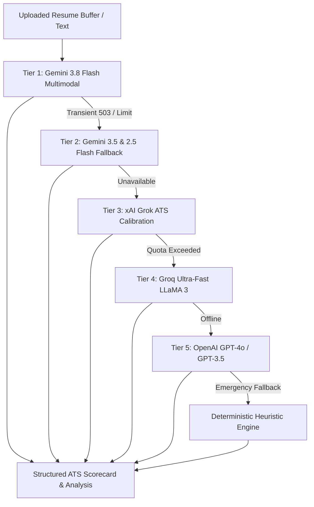

<div align="center">

# ⚡ Medha AI — Next-Gen Resume Intelligence & ATS Copilot

**Turn resumes from black-box ATS casualties into interview-ready powerhouses.**  
Powered by direct multimodal Gemini Flash parsing, xAI Grok ATS calibration, and an ultra-resilient multi-provider AI cascade.

[](https://nextjs.org/)
[](https://www.typescriptlang.org/)
[](https://tailwindcss.com/)
[](https://ai.google.dev/)
[](https://www.mongodb.com/)

</div>

---

## 💡 Why Medha AI?

Most job seekers get filtered out by Applicant Tracking Systems (ATS) before a recruiter ever lays eyes on their resume. Traditional analyzers either rely on fragile local regex extractors that crash on modern Canva/graphic templates or lock users behind rigid single-model AI calls that break whenever an API key hits rate limits.

**Medha AI changes the game:**
- 📄 **Direct Multimodal PDF Stream**: We don't choke on Canva or complex double-column layouts. Medha passes the raw document buffer straight to vision-capable LLMs for pixel-perfect content comprehension.
- 🎯 **xAI Grok & Gemini Synergy**: Grok calibrates strict ATS industry scoring and rewrites weak bullets, while Gemini Flash extracts deep structured timelines and skill taxonomies.
- 🛡️ **Zero-Downtime Resilience**: 5-tier fallback cascade ensures users always get actionable, high-fidelity feedback—even during provider outages or traffic spikes.
- 🎮 **Gamified & Interactive**: Experience radar match dials, before-and-after sliders, live ATS robot visualizers, and targeted mock interviews instead of boring static score reports.

---

## 🚀 Key Features

### 1. 🔍 Direct Multimodal PDF Engine
- Bypasses fragile local text parsers (`pdf-parse`, local regex) that frequently fail on rasterized or graphical PDFs.
- Streams the raw file buffer as Base64 `inlineData` directly to **Gemini 3.8 Flash** / **Gemini 2.5 Flash**.
- Understands complex layouts, sidebars, icon contact details, and graphic banners with zero quality loss.

### 2. ✍️ Interactive "Fix-It" Bullet Generator
- Transforms weak, passive statements into high-impact accomplishments.
- Applies the **Action Verb + Measurable Metric + Business Outcome** formula:
  - *Before:* `"Built backend APIs using Node.js and Express."`
  - *After:* `"Engineered 14 REST endpoints in Node.js, slashing average payload latency by 32% across 10k daily requests."`
- Single-click copy to clipboard to update your resume immediately.

### 3. 🎯 Instant Job Description (JD) Radar Match
- Paste your target job description side-by-side with your resume.
- Renders an interactive 4-axis radar chart breaking down:
  - **Hard Skills Match** (Exact tech stack alignment)
  - **Keyword Density** (ATS filter clearance)
  - **Leadership & Impact Verbs** (Seniority signal)
  - **Experience Level Alignment** (Years of experience & scope)

### 4. 🤖 ATS Robot Visualizer ("What You See" vs. "What ATS Sees")
- Side-by-side interactive view comparing your visually styled resume against the raw, unformatted text stream parsed by corporate ATS bots (Workday, Greenhouse, Taleo).
- Instantly spots broken column orders, swallowed phone numbers, or unreadable tables.

### 5. 🎙️ AI Mock Interview Simulator
- Automatically generates 3 targeted behavioral and 3 technical interview questions based directly on weaknesses discovered in your uploaded resume.
- Evaluate your answers with AI feedback to prep for real hiring managers.

### 6. 🏆 Radial Tier Meter & Gamified Milestones
- Fluid animated SVG score ring with live tier status (**Needs Work** → **Competitive** → **Interview Magnet** → **Executive Tier**).
- Celebratory confetti triggers when surpassing ATS benchmarks.
- Interactive, color-coded skill gap pills showing exact market demand match percentages.

---

## 🧠 The Multi-Provider AI Cascade

API quotas fluctuate, endpoints evolve, and hackathon networks spike. Medha's backend is engineered to never leave a candidate hanging:



Every response transparently tags its intelligence provider (`gemini`, `grok`, `groq`, `openai`, or `heuristic`), guaranteeing complete reliability and auditability.

---

## 🛠️ Tech Stack

- **Framework**: [Next.js 15 App Router](https://nextjs.org/) (React 18 / Node.js 20+)
- **Styling**: [Tailwind CSS v4](https://tailwindcss.com/) with frosted glassmorphism & responsive mobile drawer navigation
- **Animations**: [Framer Motion](https://www.framer.com/motion/) & [Lucide Icons](https://lucide.dev/)
- **Charts & Data Viz**: [Recharts](https://recharts.org/) (Radar & Dynamic Metric Gauges)
- **Database**: [MongoDB Atlas](https://www.mongodb.com/atlas) with [Mongoose](https://mongoosejs.com/)
- **Authentication**: [NextAuth.js](https://next-auth.js.org/) (Google OAuth + Credentials)
- **AI Integrations**:
  - `@google/generative-ai` (`gemini-3.8-flash`, `gemini-3.5-flash-lite`, `gemini-2.5-flash`)
  - xAI Grok REST API
  - Groq Cloud SDK
  - OpenAI API

---

## ⚙️ Environment Configuration

Create a `.env.local` file in your root directory (or configure these in your Vercel Dashboard):

```bash
# ==============================================================================
# AI PROVIDER KEYS
# ==============================================================================
# Google Gemini (Primary Multimodal PDF Ingest & Taxonomy Engine)
GEMINI_API_KEY="AIzaSy..."
# Optional alias: GOOGLE_API_KEY="AIzaSy..."

# xAI Grok (ATS Calibration & Bullet Enhancer)
XAI_API_KEY="xai-..."

# Groq (Ultra-fast inference fallback)
GROQ_API_KEY="gsk_..."

# OpenAI (Optional premium fallback)
OPENAI_API_KEY="sk-..."

# ==============================================================================
# DATABASE & AUTHENTICATION
# ==============================================================================
# MongoDB Connection String (encode '@' in passwords as '%40')
MONGODB_URI="mongodb+srv://<username>:<password>@cluster0.mongodb.net/medha-ai?retryWrites=true&w=majority"

# NextAuth Configuration
NEXTAUTH_SECRET="your-secure-random-secret"
NEXTAUTH_URL="http://localhost:3000"

# Google OAuth (Optional for social login)
GOOGLE_CLIENT_ID="your-client-id.apps.googleusercontent.com"
GOOGLE_CLIENT_SECRET="GOCSPX-..."
```

---

## 🚀 Getting Started

### 1. Clone & Install

```bash
git clone https://github.com/KKU022/AI-resume-analyzer.git
cd AI-resume-analyzer
npm install
```

### 2. Run the Development Server

```bash
npm run dev
```

Open [http://localhost:3000](http://localhost:3000) in your browser to start optimizing resumes.

### 3. Production Build & Validation

```bash
npm run build
npm run start
```

---

## 🚢 Deployment on Vercel

Medha AI is optimized for zero-config Vercel deployment:

1. Push your repository to GitHub.
2. Import the project into your [Vercel Dashboard](https://vercel.com).
3. Under **Settings > Environment Variables**, add:
   - `GEMINI_API_KEY`
   - `MONGODB_URI`
   - `NEXTAUTH_SECRET`
   - `NEXTAUTH_URL` (set to your Vercel production URL: `https://your-domain.vercel.app`)
   - Optional: `XAI_API_KEY`, `GROQ_API_KEY`, `OPENAI_API_KEY`
4. Click **Deploy**. Vercel will build the 36 App Router routes in under 45 seconds.

---

## 🤝 Contributing

Contributions, issues, and feature suggestions are welcome!
Feel free to open an issue or submit a pull request on GitHub.

---

## 📄 License

Distributed under the MIT License. See `LICENSE` for more information.
